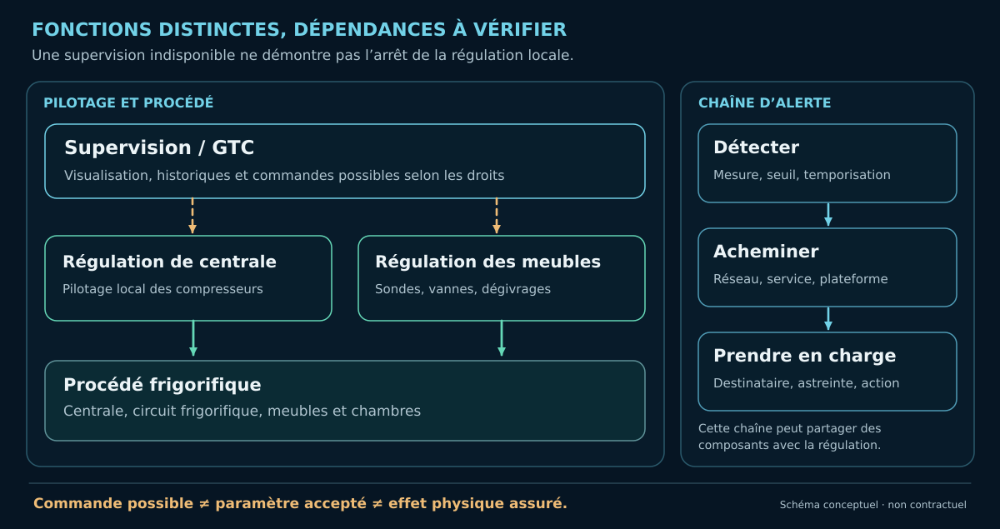
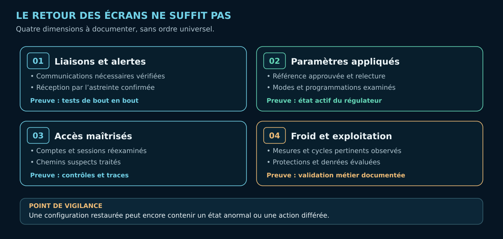

+++
title = "Cyber-résilience du froid commercial : que reste-t-il quand la supervision n'est plus fiable ?"
description = "Régulation locale, effets différés, alarmes et preuves de reprise : ce qu'une supervision disponible ne suffit pas à démontrer."
date = 2026-10-23
draft = false
template = "doc-page.html"

[extra]
author = "lxrider"
article_version = "1.0 — publication initiale"
rights = "© 2026 lxrider — Tous droits réservés pour le texte original"
+++

Le superviseur répond à nouveau. Les courbes s'affichent, les équipements semblent communiquer. **Le froid est-il pour autant revenu à un état fiable ?**

Pas nécessairement. Un régulateur peut continuer à fonctionner sans supervision. Une programmation modifiée peut produire ses effets plus tard. Une alarme peut être détectée sans jamais atteindre l'astreinte. Et une température affichée ne raconte pas, à elle seule, ce qu'ont subi les marchandises.

L'[analyse des capacités d'action](https://lxrider.github.io/publications/froid-commercial/) examinait les accès, les privilèges et les chemins permettant d'agir sur le procédé. La question est ici différente : **quelles fonctions restent opérationnelles lorsque la supervision devient suspecte, quels effets peuvent persister et quelles preuves permettent de valider la reprise ?**

Les incidents d'octobre 2026 rendent ces questions concrètes. Le [CERT-FR](https://cert.cyber.gouv.fr/alerte/CERTFR-2026-ALE-012/) rappelle notamment qu'une intervention sur les accès distants peut perturber la remontée d'informations vers le frigoriste. Couper une connexion ne suffit donc ni à décrire l'état du froid ni à garantir la continuité des alertes.

## 1. L'écran ne dit pas tout

Prenons deux situations possibles. Dans la première, le magasin perd sa télésurveillance : plus de températures à distance, plus de notifications habituelles. Pourtant, certains régulateurs peuvent continuer à commander les meubles et la centrale peut encore produire du froid.

Dans la seconde, l'interface reste disponible, mais les courbes sont anciennes, une consigne a changé ou une alarme n'a pas été traitée comme prévu. **La disponibilité de l'écran ne garantit plus la fiabilité de ce qu'il montre.**

Ces situations imposent de distinguer les fonctions : **mesurer**, **réguler**, **produire du froid** et **alerter**. Elles peuvent dépendre d'équipements, d'alimentations et de communications différents. Une panne de supervision ne prouve pas l'arrêt de la régulation ; une régulation encore active ne prouve pas que les alarmes arrivent à destination.

Il faut également distinguer la mesure et le produit. Une sonde renseigne la température à son emplacement, souvent celle de l'air. La conservation des denrées dépend aussi de la durée d'exposition, de leur historique thermique et des conditions d'exploitation. Une lecture ponctuelle ne permet pas de reconstituer à elle seule cet historique.

La première investigation porte donc sur **ce qui fonctionne encore, ce qui est devenu invisible et ce qui permet de le vérifier autrement**.

## 2. Reconstruire les dépendances du froid

Un plan réseau ne raconte qu'une partie de l'installation. Pour comprendre sa résilience, il faut suivre la chaîne fonctionnelle : **sonde → régulateur → actionneur → procédé**, puis les échanges éventuels avec la centrale, le superviseur et l'astreinte.

Les régulateurs assurent certaines décisions localement : température, ventilateurs, vannes ou dégivrages selon le matériel. Le superviseur frigorifique, parfois intégré à une **GTC**, collecte des états, conserve des historiques et peut transmettre des réglages ou commandes. Une plateforme distante peut servir à la télésurveillance et à la maintenance.

Le fait qu'une régulation soit locale ne signifie pas qu'elle soit totalement autonome. Sur les **Dixell XM669K/XM679K**, par exemple, la documentation décrit des fonctions locales mais aussi des synchronisations de consigne ou de dégivrage entre sections reliées par un LAN. Le fonctionnement réel dépend des paramètres installés. Chez Danfoss, l'**AK-CC 550** remplit des fonctions locales distinctes de celles du superviseur **AK-SM 800**.

<figure class="research-figure">

<figcaption>Figure 1 — Perdre la supervision ne signifie pas nécessairement perdre la régulation.</figcaption>
</figure>

Le point à établir est précis : **de quoi dépend chaque fonction pour continuer à agir ?** Une consigne partagée, un bus de terrain, une sonde commune ou une alimentation unique peuvent changer la réponse. Sans les modèles, les réglages et le câblage du site, aucun comportement de repli ne peut être garanti.

## 3. Une commande peut produire des effets plus tard

Une modification de consigne n'a pas nécessairement un effet immédiat sur la température. Le régulateur applique une logique, les actionneurs réagissent, puis le procédé évolue avec son inertie thermique.

La programmation des dégivrages illustre ce décalage. Un horaire ou un paramètre déjà enregistré peut agir **après** la coupure d'un accès distant. Un effet observé plus tard ne prouve donc pas qu'une nouvelle commande a été envoyée au même moment.

Les interactions entre régulateurs compliquent parfois la lecture. Les manuels **XM669K/XM679K** décrivent des mécanismes de synchronisation entre sections et des comportements de repli en cas de défaut de sonde. Ces capacités documentées n'établissent ni leur activation dans un magasin donné ni leur implication dans un incident.

L'analyse doit rapprocher quatre éléments : **le paramètre réellement appliqué, le mode actif, la chronologie des événements et l'évolution physique mesurée**. Lorsque les journaux sont incomplets, l'origine de la modification peut rester inconnue. Cela ne dispense pas de rechercher les effets encore actifs.

C'est pourquoi **révoquer un accès compromis et retrouver un état frigorifique maîtrisé sont deux opérations différentes**.

## 4. Quelles protections tiennent encore ?

Une limite de réglage, une alarme et une sécurité de pression ne protègent pas le même objectif. Pour comprendre leur valeur, il faut examiner **qui peut les modifier, ce dont elles dépendent et le dommage qu'elles préviennent**.

Une sécurité de pression peut protéger un compresseur en provoquant son arrêt, sans assurer la conservation des marchandises. Une alarme peut être visible localement sans être transmise. Deux interfaces distinctes peuvent dépendre de la même sonde, du même superviseur ou du même compte d'administration.

Un exemple documenté : sur **XWEB EVO v5.6.0**, le mode maintenance conduit la supervision XWEB à ignorer les alarmes des instruments concernés. Cela ne prouve pas que les protections câblées ou les alarmes propres aux régulateurs disparaissent. De même, une alarme de perte de liaison signale un défaut de communication avec un instrument, **pas l'arrêt établi du procédé**.

Pour chaque chaîne d'alerte, les vérifications vont de la **mesure** à la **détection**, puis à la **transmission, la réception et la prise en charge par l'astreinte**. Une surveillance séparée n'est réellement indépendante que si ses capteurs, ses communications, ses droits et ses éventuelles alimentations communes ont été examinés.

En situation dégradée, l'exploitant et le frigoriste doivent pouvoir décider sur la base de mesures fiables, même si la télésurveillance est indisponible. Les coupures d'accès, redémarrages et essais susceptibles de perturber le procédé exigent une préparation et une intervention autorisée. **La priorité reste la sécurité de l'installation et des denrées, pas le retour le plus rapide possible des écrans.**

## 5. Quelles preuves avant de déclarer la reprise ?

Une interface qui répond et une sauvegarde restaurée ne suffisent pas. Quatre dimensions sont à documenter, sans supposer qu'elles doivent être vérifiées dans un ordre universel.

- **Liaisons et alertes.** Les communications nécessaires fonctionnent-elles ? Une alarme peut-elle être suivie jusqu'à sa réception et sa prise en charge par l'astreinte, lors d'un essai autorisé ?
- **Paramètres réellement appliqués.** Les valeurs, modes, horaires et dégivrages actifs correspondent-ils à une référence approuvée ? Les réglages ont-ils été relus sur les instruments concernés ?
- **Accès maîtrisés.** Les comptes, sessions, services et chemins suspects ont-ils été examinés et traités ? Une voie de compromission n'est-elle pas restée ouverte ?
- **Froid et exploitation.** Les mesures physiques, les protections et les cycles pertinents ont-ils été validés par les professionnels compétents ? L'exploitant dispose-t-il des éléments nécessaires pour statuer sur les marchandises ?

<figure class="research-figure">

<figcaption>Figure 2 — Le retour des écrans ne suffit pas : quatre preuves complémentaires.</figcaption>
</figure>

**Le sens des opérations de restauration mérite une vérification particulière.** Dans le manuel de l'AK-SM 800 cité ici, *Upload* transfère les paramètres des régulateurs vers le superviseur, alors que *Download* les transfère du superviseur vers les régulateurs. Sur XWEB EVO, *Import*, *Write* et *Read* correspondent également à des opérations distinctes. Confondre charger une sauvegarde, envoyer des réglages et relire l'état réel peut laisser une installation dans un état inattendu.

Une sauvegarde récente peut déjà contenir des valeurs anormales. La référence de reprise doit donc être approuvée, adaptée au matériel et confrontée au comportement du procédé. Le [NIST SP 800-82r3](https://nvlpubs.nist.gov/nistpubs/SpecialPublications/NIST.SP.800-82r3.pdf) rappelle l'importance des états et des conséquences physiques lors de la restauration d'un système OT.

La validation finale est une décision conjointe : le frigoriste confirme les fonctions et les protections du procédé ; l'exploitant prend les décisions relatives aux denrées ; les responsables cyber vérifient que les accès et les systèmes numériques sont suffisamment maîtrisés. Une reprise fiable se démontre **par des états observés et des décisions tracées**, pas uniquement par un superviseur redevenu joignable.

## Conclusion

Lorsque la supervision devient incertaine, retrouver une information fiable sur le procédé constitue une première nécessité. Une surveillance alternative demande elle-même une vérification de ses capteurs, de ses communications et de ses dépendances. Il faut aussi comprendre quelles fonctions continuent à agir, quelles protections restent disponibles et quels effets peuvent se manifester après la disparition de l'incident numérique initial.

La confiance dans une installation frigorifique se reconstruit à partir de preuves concordantes : paramètres réellement appliqués, mesures physiques pertinentes, comportement des régulations au cours des cycles utiles, alarmes effectivement reçues et prises en charge, accès maîtrisés et validation par les professionnels du froid et de l'exploitation. Les conséquences sur les denrées appellent une décision métier documentée.

**La cyber-résilience se vérifie dans la capacité à comprendre le fonctionnement réel de l'installation, à limiter les conséquences d'une défaillance numérique et à démontrer une reprise fiable.** Cette démarche relie les observations du terrain aux décisions d'exploitation, y compris lorsque certains composants numériques restent indisponibles ou suspects.

### Références essentielles

- [CERT-FR — Alerte CERTFR-2026-ALE-012 (octobre 2026)](https://cert.cyber.gouv.fr/alerte/CERTFR-2026-ALE-012/).
- [ANSSI — Cybersécurité des systèmes industriels : mesures détaillées (2025)](https://messervices.cyber.gouv.fr/documents-guides/Guide_Systemes_industriels__Mesures_detaillees_v2.pdf).
- [Danfoss — AK-SM 800 Series, User Guide](https://assets.danfoss.com/documents/latest/56759/BC316842192932en-001001.pdf) et [AK-CC 550](https://assets.danfoss.com/documents/latest/55258/BC187486426386en-000701.pdf).
- [Copeland/Dixell — XWEB EVO Operating Manual v5.6.0](https://webapps.copeland.com/Dixell/Content/Pages/Manuals/XWEBEVO/XWEBEVOV5.6.0OPERATION/XWEB-EVO-r5.6.0-OPR-EN.pdf).
- [Copeland/Dixell — XM669K/XM679K, manuel français v5.4d](https://webapps.copeland.com/Dixell/Content/Pages/Manuals/XM400600/XM669K-XM679KR5.4/XM669K-XM679K-FR-r5.4.pdf).
- [NIST — Guide to Operational Technology (OT) Security, SP 800-82r3](https://nvlpubs.nist.gov/nistpubs/SpecialPublications/NIST.SP.800-82r3.pdf).
**Lecture complémentaire :** [Joe Weiss, *The trust gap in control system cybersecurity* (21 octobre 2026)](https://www.controlglobal.com/blogs/unfettered/blog/55413473/the-trust-gap-in-control-system-cybersecurity-iranian-water-hacks-and-french-refrigeration-attacks-demonstrate-why-independent-process-monitoring-is-essential), sur la confiance dans les mesures du procédé. Cette tribune contient également une présentation commerciale ; elle ne constitue ni une preuve des mécanismes des incidents français ni une validation indépendante de la solution présentée.

*Portée : analyse fondée sur des fonctions documentées, sans diagnostic d'une installation précise. L'autonomie locale, l'indépendance des protections, les effets différés et les critères de reprise doivent être confirmés sur les équipements et configurations réellement installés. Une revue frigorifique indépendante reste à réaliser.*

---

*Version 1.0 — publication initiale, 23 octobre 2026. © 2026 lxrider — Tous droits réservés pour le texte original. Schémas conceptuels.*
