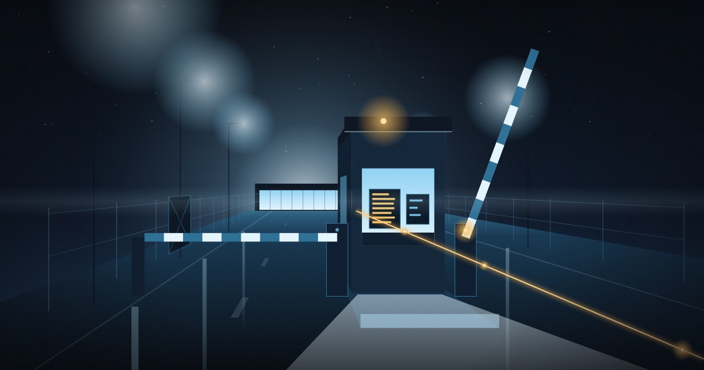
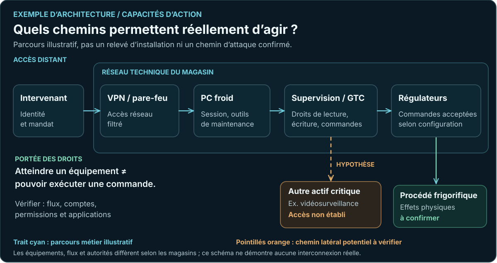
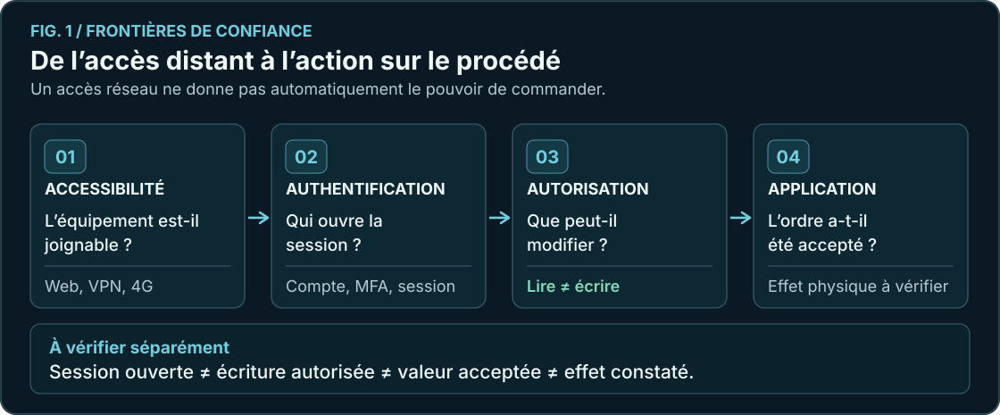
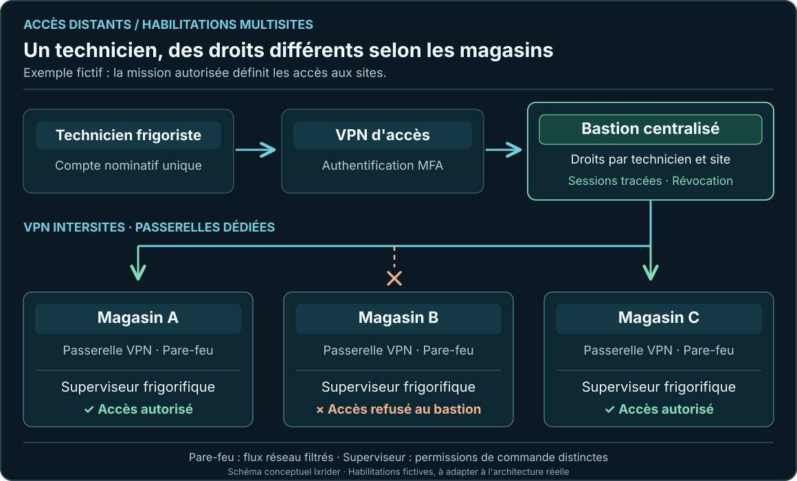
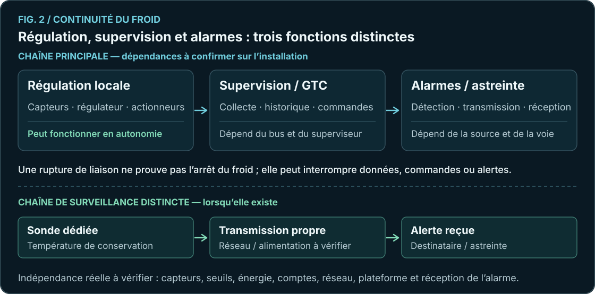

+++
title = "Cybersécurité du froid commercial : qui peut agir sur vos installations, et jusqu'où ?"
description = "Des accès aux consignes de froid : comprendre les droits, les chemins d'action et leurs conséquences."
date = 2026-10-22
draft = false
updated = 2026-10-25
template = "doc-page.html"

[extra]
article_version = "1.4.1 — illustration d’ouverture actualisée"
author = "lxrider"
rights = "© 2026 lxrider — Tous droits réservés"
+++

Dans un magasin, plusieurs intervenants accèdent aux installations frigorifiques. Le frigoriste consulte les températures, l'intégrateur configure la supervision et le prestataire informatique administre les accès réseau.

**Que peut réellement faire chacun ?** Consulter une température, modifier une consigne, acquitter ou inhiber une alarme, administrer un équipement : chaque opération mobilise des permissions différentes.

Cette analyse relie **les chemins d'accès, les identités et les capacités d'action** : quelles permissions permettent d'agir sur quels équipements, et jusqu'où s'étend leur portée ?

Les incidents d'octobre 2026 concernant des supervisions Danfoss et Copeland/Dixell ont rappelé l'importance de ces questions. Le [CERT-FR](https://www.cert.cyber.gouv.fr/alerte/CERTFR-2026-ALE-012/) recommande notamment de supprimer les accès de gestion directement exposés sur Internet. Les informations publiques ne permettent pas pour autant d'établir un chemin initial unique de compromission.

Le [guide pratique de sécurisation des supervisions](https://lxrider.github.io/publications/securiser-supervision-frigorifique/) détaille la maîtrise des accès distants. Ici, nous suivons **ce qu'une identité compromise pourrait commander et les protections qui limiteraient sa portée**.

<figure class="research-figure">

<figcaption>Chemins d'accès et frontières de confiance — Franchir un contrôle d'accès ne signifie pas disposer de toutes les capacités d'action sur les installations. Illustration conceptuelle lxrider.</figcaption>
</figure>

## 1. Quels chemins mènent aux installations ?

Le premier travail consiste à reconstruire les accès. Ceux que tout le monde connaît, mais aussi ceux qui ont pu être ajoutés au fil des interventions.

Un superviseur peut être joignable depuis le réseau du magasin, un VPN, un PC froid, une box avec redirection de port ou un routeur cellulaire. Une plateforme extérieure peut donner accès à plusieurs établissements. Et un changement de prestataire ne fait pas nécessairement disparaître tous les anciens chemins.

Sur le terrain, les fonctions sont réparties entre des **régulateurs**, qui assurent la conduite locale, et des **systèmes de supervision**, qui collectent des informations et peuvent, selon les configurations et les droits, transmettre des commandes. Un Danfoss AK-SM et un régulateur AK-PC n'ont pas le même rôle. Les familles XWEB présentent elles aussi des fonctions différentes selon les générations.

Dans certaines installations, la gestion technique centralisée du froid (**GTC**) échange avec une gestion technique du bâtiment (**GTB**) ou une supervision multisite. **Les flux réellement échangés et les éventuelles commandes autorisées** sont à identifier : une remontée de mesures et une fonction de pilotage ont des portées différentes.

**Par quels chemins les équipements sont-ils joignables, et qui maîtrise ces chemins ?** Un schéma simple aide à poser les bonnes questions, avant de vérifier les liaisons et les permissions sur le site réel.

<figure class="research-figure">

<figcaption>Exemple d'architecture — Du PC froid aux régulateurs. Le chemin vers la vidéosurveillance est une hypothèse à vérifier, pas une interconnexion constatée.</figcaption>
</figure>

## 2. Se connecter donne-t-il le pouvoir de modifier ?

Un compte ouvre l'interface d'un superviseur. Pour mesurer son pouvoir, il faut ensuite vérifier **ce que le compte peut consulter, modifier et commander**.

Pour qualifier une capacité d'action, quatre vérifications sont nécessaires : l'équipement est-il **joignable**, l'identité est-elle **reconnue**, possède-t-elle les **droits nécessaires**, et l'ordre est-il **accepté et appliqué** par le régulateur ?

<figure class="research-figure">

<figcaption>Figure 1 — Entre l'accès réseau et l'action sur le froid, quatre vérifications.</figcaption>
</figure>

Consulter une température, acquitter une alarme, modifier une consigne et administrer un équipement correspondent à **des opérations et à des conséquences différentes**.

La documentation de [XWEB PRO](https://webapps.copeland.com/Dixell/Content/Pages/Manuals/XWEBPRO/XWEBPROV1.2OPERATION/XWEB-PRO-OPR-EN.pdf) distingue par exemple la lecture des paramètres, leur modification et l'envoi de commandes. Chez [Danfoss](https://www.danfoss.com/en/service-and-support/downloads/dcs/adap-kool-software/ak-sm-800a/), les niveaux de permission et les services disponibles dépendent également du produit, de la version et des réglages.

Ces documentations montrent ce que les systèmes *peuvent* autoriser. **Les capacités d'action effectives dépendent des comptes, des droits et des réglages propres à chaque site.**

C'est le principe du **moindre privilège** : attribuer à chacun les droits utiles à sa mission. Un compte de consultation sert à lire les températures ; les droits de modification et d'administration sont attribués aux interventions qui les exigent. Lorsque les équipements le permettent, séparer ces fonctions limite le pouvoir d'une identité compromise.

### Qui donne le pouvoir d'agir ?

Un frigoriste peut intervenir avec des accès fournis par l'enseigne, son entreprise de maintenance ou un intégrateur. Sur certains parcs, le VPN, le bastion, la plateforme multisite et le superviseur possèdent chacun leurs propres comptes et administrateurs.

Trois questions permettent de comprendre l'autorité réellement exercée :

- **Mission autorisée :** qui demande et valide l'intervention, sur quel magasin et pour quelles opérations ?
- **Privilèges techniques :** quels équipements et commandes le compte permet-il effectivement d'atteindre, depuis le point d'accès jusqu'au superviseur ?
- **Administration des droits :** qui crée les comptes, étend les permissions et peut les retirer, y compris chez un prestataire ?

**Exemple fictif :** un technicien consulte une alarme sur le magasin A. Le compte utilisé dispose aussi, selon les permissions configurées, de droits d'écriture sur les magasins B et C. **La mission concerne un magasin ; l'identité possède des capacités sur trois.** Cet écart mérite une revue, même lorsque l'intervention se déroule normalement.

L'évaluation doit donc suivre **l'intervenant, le compte utilisé, les personnes qui gèrent ce compte et les équipements qu'il peut modifier**.

### Un parc de magasins : comment répartir les accès ?

Pour une entreprise frigorifique intervenant sur plusieurs magasins, une architecture possible s'appuie sur **un bastion centralisé**, des liaisons VPN et des règles de filtrage propres à chaque site.

- **Le technicien** utilise un compte nominatif unique. Il rejoint l'infrastructure d'accès par un **VPN avec authentification multifacteur (MFA)**, puis ouvre sa session de maintenance sur le bastion.
- **Le bastion** applique ses habilitations : quels magasins et quels superviseurs ce technicien peut atteindre. Il trace les connexions et, selon les protocoles et ses fonctionnalités, les sessions.
- **Le réseau** relie la zone de maintenance aux magasins par des **VPN intersites**, terminés sur des passerelles adaptées. Le **pare-feu de chaque magasin** limite les flux aux superviseurs et aux services nécessaires.
- **Le superviseur** conserve sa propre gestion des comptes et des commandes. Ses permissions déterminent ce que l'intervenant peut effectivement consulter ou modifier une fois connecté.

<figure class="research-figure">

<figcaption>Exemple — Habilitations multisites via bastion : une identité par technicien, des accès autorisés par magasin, un filtrage réseau sur chaque site et des permissions propres aux superviseurs. Schéma conceptuel lxrider.</figcaption>
</figure>

Cette chaîne sépare plusieurs autorités. **L'exploitant ou l'enseigne valide l'accès à ses magasins**, l'entreprise frigorifique tient à jour la liste de ses techniciens et l'administrateur de l'infrastructure applique les habilitations convenues. À chaque départ ou changement de périmètre, les accès correspondants sont réexaminés et révoqués.

**Le bastion concentre lui aussi des privilèges :** son administration et les comptes techniques utilisés vers les superviseurs méritent une attention particulière. Sur les équipements anciens, un compte local partagé peut subsister ; la traçabilité individuelle des actions dépend alors des fonctions du bastion et du protocole de connexion.

Le [guide pratique des accès distants](https://lxrider.github.io/publications/securiser-supervision-frigorifique/) détaille la mise en place de cette chaîne, les contrôles de connexion et les précautions de télémaintenance. Le point examiné ici est **l'écart éventuel entre les missions accordées et les capacités réelles des identités**.

## 3. Jusqu'où une modification peut-elle se propager ?

Une même identité peut parfois modifier un équipement isolé ; ailleurs, elle dispose de droits sur plusieurs régulateurs, une centrale, voire plusieurs magasins. Son périmètre d'action ne s'arrête pas nécessairement au superviseur.

Le *blast radius* désigne le **périmètre potentiellement affectable** par une compromission : les fonctions modifiables, les équipements et les sites concernés, mais aussi les autres systèmes éventuellement accessibles depuis un équipement compromis.

Prenons un exemple précis. Sur le régulateur [Dixell XR60CX](https://webapps.copeland.com/Dixell/Content/Pages/Manuals/XR-CX/XR60CX/XR60CX-FR.pdf), le paramètre **SEt** définit une consigne, tandis que **US** peut fixer sa limite supérieure. Si une même autorité peut modifier la consigne **et** sa limite, cette limite ne constitue plus une protection indépendante contre cette autorité.

Cet exemple illustre une **dépendance entre deux réglages**. Sa portée sur un magasin donné dépend des droits effectifs, des protections physiques et de la configuration des régulateurs.

Sur une plateforme multisite, **voir les magasins et pouvoir les modifier sont deux fonctions distinctes**. Les permissions d'écriture, leurs limites et leur administrateur déterminent la concentration réelle des capacités d'action.

### Et si l'accès dépassait le froid ?

Le **mouvement latéral** désigne la progression d'un adversaire d'un système compromis vers d'autres systèmes. C'est une possibilité à examiner dans les architectures où un **PC froid** ou un superviseur communique avec d'autres réseaux du magasin. Exemple : un chemin vers une infrastructure de vidéosurveillance. Cette question ne se limite plus aux températures ou aux régulateurs. Elle concerne aussi les capacités d'action sur les systèmes voisins. [MITRE ATT&CK](https://attack.mitre.org/tactics/TA0008/) documente ce type de progression.

**Une communication possible ne démontre pas qu'un mouvement latéral soit réalisable.** Il faut vérifier les règles de filtrage, les services exposés, les comptes utilisables et les permissions obtenues. L'accès à l'interface Web d'un superviseur ne prouve ni un accès à son système d'exploitation ni un pouvoir d'administration sur la vidéosurveillance.

D'autres actions méritent la même analyse : altération de paramètres, inhibition d'alarmes ou suppression d'historiques, **si les droits et les fonctions disponibles les rendent possibles**. Ces exemples sont des hypothèses de capacités, pas des faits établis pour les incidents d'octobre 2026.

Il faut ensuite relier chaque capacité au procédé : quelles consignes peuvent changer ? Quels dégivrages, seuils ou programmes sont concernés ? Quelles sécurités resteraient indépendantes ?

Une protection mécanique peut préserver un compresseur sans garantir la température des denrées. Le risque se mesure donc aussi au regard du **service que l'installation doit assurer**.

## 4. Quand les alarmes disparaissent, quelles capacités restent ?

Selon le matériel et les réglages, certains régulateurs poursuivent leur fonctionnement local après la perte du superviseur ou de la liaison extérieure. **La production de froid et la transmission des alarmes suivent alors des chemins différents.**

<figure class="research-figure">

<figcaption>Figure 2 — Le froid peut continuer alors que les alarmes ne remontent plus.</figcaption>
</figure>

Les conséquences dépendent aussi des **droits d'administration sur les seuils, les notifications et les programmes**. Une identité capable de changer un seuil d'alerte ou sa destination peut affecter la surveillance, tandis qu'une perte de liaison peut interrompre la remontée d'informations.

Pour analyser le périmètre d'action, il faut distinguer **la régulation, les protections locales et l'alerte reçue par l'astreinte**, puis examiner leurs dépendances éventuelles : comptes, sondes, réseau, alimentation et configuration.

L'[analyse de cyber-résilience](https://lxrider.github.io/publications/cyber-resilience-froid-commercial/) développe la continuité de la régulation, l'indépendance des protections, les sauvegardes et les preuves nécessaires à une reprise fiable.

## 5. Que vérifier, sans compliquer inutilement le métier ?

Une évaluation utile commence par **quelques questions que l'on peut confronter aux installations et aux comptes existants** :

- **Accès :** savons-nous comment chaque intervenant rejoint les installations, y compris par les chemins secondaires ?
- **Autorité :** qui valide l'accès à chaque magasin, qui gère les habilitations sur le bastion et quels droits d'administration sont effectivement attribués ?
- **Moindre privilège :** qui peut lire, modifier une consigne, changer ses limites ou envoyer une commande, et pour quelle mission ?
- **Périmètre :** quels autres équipements, magasins ou systèmes critiques seraient atteignables depuis l'accès considéré ?
- **Alertes :** qui peut modifier les seuils et les destinataires des alarmes, et qui vérifie leur réception ?
- **Maîtrise :** qui peut révoquer un accès ou réduire les permissions, y compris lorsque les comptes sont administrés par un prestataire ?

Le frigoriste connaît le procédé et les contraintes de maintenance. Le prestataire réseau maîtrise les communications qu'il administre. Le spécialiste en cybersécurité relie les **expositions, identités, privilèges et chemins d'action**, y compris entre systèmes, pour mesurer les conséquences possibles. Ces regards se complètent, sans imposer les mêmes compétences à chacun.

La réponse doit rester proportionnée aux moyens de l'entreprise. Supprimer un ancien accès, réduire un privilège ou tester une alarme peut avoir plus de valeur que multiplier les équipements de sécurité. Quand un matériel obsolète ou une dépendance critique empêche de maîtriser le risque, il faut en revanche envisager des mesures compensatoires ou son remplacement.

L'objectif est d'aboutir à **quelques décisions vérifiables et maintenables**, appuyées sur des comptes, des configurations et des responsabilités identifiés.

## Conclusion

La question de départ paraît simple : *qui peut agir sur nos installations frigorifiques ?*

La réponse se construit en reliant **les missions autorisées, les identités, les administrateurs des droits et les commandes réellement possibles**, puis en suivant leur portée vers les régulateurs, les autres magasins et les systèmes voisins.

C'est dans ces relations que se trouvent les chemins de compromission possibles et les concentrations d'autorité les plus importantes à maîtriser.

**Connaître ces chemins permet de protéger ce qui compte : le froid, les denrées et la capacité d'intervenir.**

### Références essentielles

- [CERT-FR — Alerte sur les équipements de supervision frigorifique, octobre 2026](https://www.cert.cyber.gouv.fr/alerte/CERTFR-2026-ALE-012/).
- [ANSSI — Recommandations de sécurité relatives à la GTB/GTC](https://messervices.cyber.gouv.fr/guides/recommandations-gestion-technique-batiment).
- [Danfoss — Documentation AK-SM 800A et contrôle des sessions](https://www.danfoss.com/en/service-and-support/downloads/dcs/adap-kool-software/ak-sm-800a/).
- [Copeland/Dixell — XWEB PRO, manuel d'exploitation](https://webapps.copeland.com/Dixell/Content/Pages/Manuals/XWEBPRO/XWEBPROV1.2OPERATION/XWEB-PRO-OPR-EN.pdf).
- [Copeland/Dixell — XR60CX, notice française](https://webapps.copeland.com/Dixell/Content/Pages/Manuals/XR-CX/XR60CX/XR60CX-FR.pdf).
- [Dixell France — Recommandations de sécurisation XWEB, octobre 2026](https://dixell.fr/wp-content/uploads/2026/10/Recommandations-pour-une-utilisation-securisee-des-superviseurs-XWEB-v1.0.pdf).

Pour les éléments techniques de l'incident et leurs limites : [étude indépendante Danfoss/XWEB v1.0](https://github.com/lxrider/danfoss-xweb-case-study/blob/main/ETUDE.md).

*Les parcours et schémas sont conceptuels. Les capacités décrites proviennent de documentations techniques ; leur activation sur une installation particulière doit être établie. Les vecteurs et droits utilisés lors des incidents d'octobre 2026 restent partiellement inconnus.*

---

*Version 1.4.1 — 25 octobre 2026 — illustration d’ouverture actualisée. © 2026 lxrider — Tous droits réservés. Schémas conceptuels, à confronter aux configurations réelles.*
