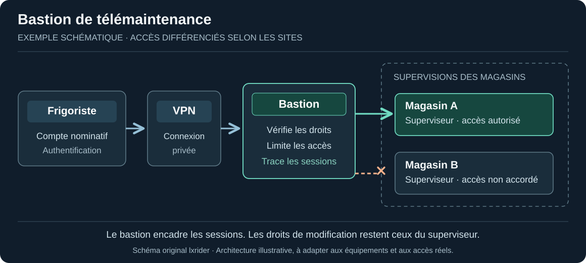

+++
title = "Sécuriser sa supervision frigorifique : guide pratique pas à pas"
description = "Danfoss, XWEB, box Internet et télémaintenance : comprendre une exposition et protéger les accès sans interrompre le froid ni les alarmes."
date = 2026-10-22
draft = false
template = "doc-page.html"

[extra]
author = "lxrider"
subtitle = "Danfoss, XWEB, box Internet et télémaintenance"
+++

Un frigoriste doit parfois accéder au superviseur d'un magasin sans se déplacer : pour consulter les températures, vérifier des alarmes ou effectuer une opération de maintenance. **Pouvoir intervenir à distance est utile. Laisser l'interface du superviseur accessible directement depuis Internet augmente le risque de compromission de l'installation.**

À la suite des incidents d'octobre 2026, le [CERT-FR recommande de supprimer cette exposition](https://cert.cyber.gouv.fr/alerte/CERTFR-2026-ALE-012/) et de privilégier un VPN ou un réseau protégé. L'objectif de ce guide est de comprendre le problème, de repérer les accès concernés et de les sécuriser **sans interrompre le froid, les alarmes ni l'astreinte**.

<figure class="research-figure">

<figcaption>Illustration d'ouverture lxrider — Représentation conceptuelle d'une installation frigorifique.</figcaption>
</figure>

## 1. Comprendre la différence entre accès distant et exposition Internet

### Imaginez le local technique d'un magasin

Le superviseur est comme un équipement installé dans un local technique. Les frigoristes doivent pouvoir y accéder pour travailler, y compris à distance.

**Une interface directement exposée à Internet, c'est comme une porte de ce local donnant sur la rue.** Même si cette porte est fermée par un code  (le mot de passe) elle est visible et peut faire l'objet de tentatives d'accès.

**Un VPN est comparable à une entrée réservée aux intervenants autorisés.** Le technicien établit d'abord une connexion privée avec le réseau du magasin, puis accède au superviseur selon les droits qui lui ont été accordés. La porte donnant directement sur la rue n'est plus nécessaire.

**L'analogie a une limite :** un VPN ne dispense pas de gérer les comptes, les mots de passe et les autorisations du superviseur.

<figure class="research-figure">

<figcaption>Figure 1. Deux façons d'accéder au superviseur : directement depuis Internet ou par un accès privé. Les alarmes suivent éventuellement un autre chemin. Schéma original lxrider.</figcaption>
</figure>

### Et les alarmes ?

Une alarme envoyée depuis le magasin vers un destinataire extérieur ressemble davantage à **un appel passé depuis le local technique** : elle peut sortir sans qu'une porte d'entrée publique reste ouverte.

Mais certaines plateformes de télésurveillance **interrogent le superviseur depuis l'extérieur**. Avant de fermer un accès, il faut donc savoir **qui initie la communication** et tester la réception des alarmes après intervention.

**À retenir : l'accès distant peut être indispensable. L'exposition publique directe du superviseur ne l'est généralement pas.**

## 2. Identifier comment le superviseur est accessible

### Comprendre le trajet d'une connexion

La **box Internet** ou le **routeur 4G** relie le magasin à Internet. À l'intérieur, les équipements — superviseur, éventuellement PC froid — communiquent sur un **réseau local (LAN)**. Chacun possède généralement une **adresse IP privée** : par exemple `192.168.1.50` pour un superviseur fictif.

Un **port** est le numéro utilisé pour joindre un service sur un équipement : par exemple une interface Web. Le port `443` est souvent utilisé pour HTTPS, mais **le port d'un superviseur dépend de sa configuration**.

La box peut également disposer d'une **adresse IP publique** : c'est l'adresse par laquelle on peut la joindre depuis Internet. Une **redirection de port (NAT/PAT)** lui indique alors où transmettre une connexion reçue sur un **port externe** : vers l'adresse privée et le port du superviseur.

<figure class="research-figure">
  
  <figcaption>Figure 2. Exemple fictif de redirection NAT/PAT. Les adresses et ports ne sont pas des réglages Danfoss ou XWEB à reproduire. Schéma original lxrider.</figcaption>
</figure>

Dans cet exemple, **8443** est le port externe de la box, **192.168.1.50** l'adresse privée du superviseur et **443** son port interne. Une telle règle crée un **chemin possible** vers le superviseur ; elle ne prouve ni que le service répond ni qu'une intrusion a eu lieu.

### Vérifier l'exposition, sans modifier la configuration

**1. Demandez au responsable réseau** l'adresse ou le lien normalement utilisé pour la télémaintenance, ainsi que son accord pour effectuer la vérification.

**2. Depuis un téléphone en données mobiles**, avec le Wi-Fi et tout VPN désactivés, essayez d'ouvrir **cette adresse connue et autorisée**. Si la page de connexion propre au superviseur apparaît directement, sans passer par un accès privé, **son interface Web est accessible depuis Internet**, même si elle exige un mot de passe.

**3. Interprétez correctement le résultat :** voir la page de connexion **ne prouve pas que quelqu'un a piraté le superviseur**. À l'inverse, ne pas voir cette page **ne garantit pas l'absence d'exposition** : d'autres ports, protocoles ou chemins d'accès peuvent exister.

Il ne s'agit **pas de rechercher ou scanner des équipements sur Internet**. La vérification porte uniquement sur une installation dont vous êtes autorisé à contrôler l'accès.

### Où repérer une redirection sur la box ?

Avec la personne habilitée, cherchez les règles pointant vers le superviseur ou un **PC froid**. Relevez l'**adresse de destination**, le **port externe**, le **port interne** et, si disponible, le **protocole** (TCP/UDP). **Pour l'instant, ne supprimez aucune règle.**

<figure class="research-figure">
  
  <figcaption>Figure 3. Exemples de menus, pas de configurations exposées : repères lxrider d'après l'<a href="https://assistance.orange.fr/ordinateurs-peripheriques/installer-et-utiliser/les-consoles-de-jeux/xbox/livebox-5-configurer-les-regles-nat-pour-pouvoir-utiliser-un-jeu-ou-une-application-serveur_287340-827962">assistance Orange (Livebox 5)</a> et l'<a href="https://assistance.free.fr/articles/1395">assistance Free (Freebox Connect)</a>. Les menus varient selon le matériel.</figcaption>
</figure>

**Une absence de redirection NAT ne suffit pas à conclure.** Selon le site, le responsable réseau devra aussi considérer une DMZ, IPv6, un routeur 4G indépendant, un accès cloud ou un outil de téléassistance.

### Ce que vous pouvez faire aujourd'hui

Même sans droits d'administration sur la box, vous pouvez **identifier le superviseur et son modèle**, noter **comment le prestataire intervient habituellement** et contacter **l'exploitant ou le responsable réseau** pour demander une vérification.

**Message prêt à transmettre :**

> « Sur le site [nom], nous utilisons un superviseur [modèle] avec un accès distant [connu / à confirmer]. Pouvez-vous vérifier si son interface est directement accessible depuis Internet et organiser sa protection ? Avant toute modification, il faut confirmer avec le frigoriste et l'astreinte le fonctionnement des alarmes et de la télémaintenance. »

## 3. Préparer l'intervention sans interrompre le froid

**Avant de modifier l'accès, identifiez ce qui doit continuer à fonctionner.** Notez le modèle et la version du superviseur, le mode de connexion (box, routeur 4G, VPN, PC froid), le prestataire de maintenance et les destinataires des alarmes.

Vérifiez notamment **qui reçoit les alertes la nuit**, comment une intervention à distance est déclenchée, si les alarmes sont **envoyées par le superviseur** ou si une plateforme extérieure **interroge le site**, et ce que prévoient le contrat de maintenance et, le cas échéant, les exigences de l'assureur.

### Qui fait quoi ?

Un frigoriste n'a pas toujours la main sur le réseau ; inversement, le responsable informatique ne connaît pas nécessairement le fonctionnement de la chaîne du froid. **La modification doit donc être coordonnée.** Inscrivez un nom et un téléphone pour chaque rôle ; une personne peut cumuler plusieurs fonctions.

| Intervenant | Avant et pendant la modification |
| --- | --- |
| **Exploitant → décide** | Valide l'intervention, le créneau et la procédure de repli. |
| **Responsable réseau / prestataire IT → réalise** | Prépare l'accès privé, vérifie les droits, effectue la modification et confirme la fermeture de l'accès public direct. |
| **Frigoriste → valide le fonctionnement** | Vérifie l'accès de télémaintenance et les fonctions utiles de supervision. |
| **Astreinte / télésurveilleur → confirme les alarmes** | Participe à un essai convenu et confirme la réception des alertes ainsi que le moyen de secours. |

**Ne coupez pas la box, la 4G ou une redirection à l'aveugle.** Il faut d'abord connaître les dépendances, disposer d'un accès de remplacement fonctionnel et prévoir un retour arrière si la télémaintenance ou les alarmes cessent de fonctionner.

## 4. Remplacer l'accès direct par une connexion protégée

L'objectif est de **conserver la télémaintenance pour les personnes autorisées**, tout en supprimant l'accès direct à l'interface depuis Internet. Un **VPN** établit une connexion privée entre le technicien et le réseau du site ; les droits doivent ensuite limiter les équipements accessibles.

### Quel accès privé choisir ?

**VPN et bastion ne sont pas deux solutions à opposer.** Le premier établit un chemin privé vers le site ; le second peut encadrer les interventions qui empruntent ce chemin. Avant d'ajouter un équipement, vérifiez si un VPN déjà administré peut être réutilisé.

| Situation sur site | Solution à examiner | Vérification indispensable |
| --- | --- | --- |
| VPN d'entreprise existant | Le réutiliser avec un accès filtré aux équipements frigorifiques nécessaires | Comptes nominatifs, équipements accessibles et droits |
| Box avec serveur VPN compatible | VPN de la box, par exemple [WireGuard sur certaines Freebox](https://assistance.free.fr/articles/1970) | Compatibilité, authentification, filtrage et maintenance |
| Petite installation sans VPN adapté | Routeur VPN administré ou passerelle d'accès privé | Responsable des mises à jour, des comptes et du dépannage |
| Site équipé d'un routeur 4G | VPN compatible avec le routeur ou solution gérée par le prestataire | Possibilités de connexion, secours et réception des alarmes |
| Plusieurs magasins ou prestataires | **Accès privé + bastion de télémaintenance**, si la complexité le justifie | Permissions par site, traçabilité des sessions et accès de secours |

**Passerelle et bastion, quelle différence ?** Une passerelle VPN permet à un technicien autorisé de rejoindre des équipements du réseau local. Un routeur VPN peut remplir ce rôle ; un Raspberry Pi avec [Tailscale](https://tailscale.com/docs/features/subnet-routers) en est un autre exemple, **à condition d'être correctement administré**.

Le **bastion**, lui, contrôle le passage des intervenants vers les équipements autorisés et peut tracer les sessions, selon les fonctions disponibles. **Il complète l'accès privé, sans remplacer les permissions du superviseur.** Cette distinction est illustrée dans le schéma ci-dessous.

La passerelle doit donner accès **aux seuls équipements et services nécessaires**, pas à tout le réseau du magasin. Ne l'ajoutez pas à un PC froid critique sans accord et analyse préalable.

**Et les accès Web ?** [Cloudflare Tunnel avec Access](https://developers.cloudflare.com/cloudflare-one/setup/secure-private-apps/private-web-app/) peut convenir à certaines applications Web compatibles. Il **ne constitue pas une solution par défaut** pour des interfaces anciennes Danfoss ou XWEB.

### Et le bastion de télémaintenance ?

**Le VPN protège le chemin d'accès ; il ne limite pas automatiquement ce qu'un technicien peut administrer.** Quand plusieurs frigoristes ou prestataires interviennent sur différents magasins, un **bastion d'administration** peut servir de point de passage contrôlé, au sein d'une chaîne d'accès sécurisée.

Selon ses fonctionnalités et les protocoles utilisés, il peut :

- **Identifier** chaque intervenant avec un compte nominatif et une authentification renforcée ;
- **Limiter** les sites et équipements accessibles, ainsi que la durée d'une intervention ;
- **Tracer** les connexions et, lorsque c'est possible, les sessions réalisées.

**Exemple :** le prestataire intervient sur le superviseur du magasin A sans obtenir, par défaut, l'accès aux autres magasins. Mais si son compte reste administrateur sur ce superviseur, **le bastion ne supprime pas ses droits de modification**.

<figure class="research-figure">

<figcaption>Figure 4. Bastion de télémaintenance : un intervenant, deux magasins, des droits d'accès différents. Exemple conceptuel lxrider.</figcaption>
</figure>

**Un bastion ne remplace ni le VPN, ni le cloisonnement, ni les droits propres aux équipements.** Il concentre des accès sensibles et doit être protégé, maintenu et secouru. Il faut aussi vérifier que les alarmes continuent de fonctionner indépendamment de cette voie de maintenance. Sur un site simple, un VPN correctement filtré peut être plus facile à exploiter ; sur un parc multisite, le bastion mérite d'être étudié.

L'[ANSSI recommande une chaîne d'accès dédiée avec bastion pour les prestataires en GTB/GTC](https://messervices.cyber.gouv.fr/documents-guides/Guide__Systemes_industriels___GTB_GTC_2025.pdf). Cette recommandation éclaire le froid commercial, sans valoir diagnostic de chaque installation.

### Si le VPN n'est pas prêt : une protection temporaire

Un **pare-feu**, parfois intégré à la box, peut **autoriser ou refuser les connexions** selon leur origine. Le *filtrage par adresse IP source* consiste, par exemple, à n'autoriser que les connexions provenant de l'**adresse Internet publique connue du prestataire**, et à refuser les autres.

Cette adresse « source » indique **d'où vient la connexion** ; elle ne désigne pas le superviseur. Si l'adresse du prestataire change, la règle peut empêcher sa télémaintenance.

Le [CERT-FR](https://cert.cyber.gouv.fr/alerte/CERTFR-2026-ALE-012/) envisage ce filtrage **en urgence seulement** : il réduit l'exposition, mais **ne remplace pas un accès privé**. L'interface reste accessible depuis les adresses autorisées.

**À faire par le responsable réseau :** vérifier que le matériel permet ce filtrage, identifier les adresses du prestataire, confirmer les alarmes et prévoir le remplacement rapide de cette mesure provisoire. **Ne modifiez pas les règles à l'aveugle.**

### Vérifier les comptes, sans confondre les protections

En parallèle, faites examiner par le mainteneur les comptes **par défaut, partagés ou inutilisés**. Les comptes d'administration doivent avoir des mots de passe **uniques et robustes** ; leur modification doit préserver les accès ou services qui en dépendent.

**Changer un mot de passe ne ferme pas une exposition Internet.**

Pour les **XWEB EVO**, le bulletin Copeland demande le retrait de l'exposition publique. Cette génération n'étant plus corrigée, il faut aussi planifier une migration vers un équipement maintenu.

### Dans quel ordre effectuer la bascule ?

1. **Le responsable réseau met en place et teste l'accès privé**, avec le frigoriste, sans encore supprimer l'ancien accès.
2. **Le frigoriste et l'astreinte vérifient les fonctions essentielles**, notamment la télémaintenance et la réception des alarmes, suivant la procédure prévue.
3. **L'exploitant autorise le changement** ; le responsable réseau retire alors l'accès direct et contrôle qu'il n'en reste pas d'autre. Les essais sont répétés après la modification (étape 5).

## 5. Vérifier que tout fonctionne après l'intervention

Pendant la **fenêtre approuvée par l'exploitant**, le responsable réseau retire la publication directe, une fois la nouvelle voie d'accès vérifiée.

Le frigoriste contrôle les fonctions utiles à l'installation ; l'astreinte confirme la réception des alertes. **Si un service indispensable ne fonctionne plus**, l'équipe applique le repli prévu et fait arbitrer la suite par l'exploitant. Toute protection provisoire doit avoir un responsable et une échéance.

### Checklist de fin d'intervention

- [ ] Superviseur, box/4G, PC froid et chemins d'accès identifiés.
- [ ] Exploitant, responsable réseau, frigoriste et astreinte identifiés ; intervention autorisée.
- [ ] Contrat, alarmes, dépendances et solution de repli vérifiés.
- [ ] Nouvelle télémaintenance testée avec un compte **autorisé** et accès **refusé** aux autres ; comptes à privilèges et mots de passe revus avec le mainteneur. Si un bastion est déployé, vérifier les droits par site, les journaux de connexion et l'accès de secours.
- [ ] Accès public direct retiré et absence de chemin direct résiduel vérifiée avec l'IT.
- [ ] Alarmes **émises et réellement reçues** par l'astreinte, avec un test convenu **sans perturber le procédé frigorifique**.
- [ ] Consignes, programmations de dégivrage, état des équipements et températures réelles, si pertinentes, contrôlés et comparés à l'état attendu.
- [ ] Procédure de secours, comptes, mises à jour et **responsable du maintien en sécurité** consignés.

**Si une compromission est suspectée :** ce guide de prévention ne suffit pas. Alertez le responsable d'incident et suivez les consignes applicables du **constructeur** et du **CERT-FR**, en préservant les constats. **Ni redémarrage, ni remise à zéro, ni changement de passerelle IP, ni désactivation générale d'UPnP/IPv6** ne doivent être improvisés comme geste préventif.

Une installation mieux protégée n'est pas simplement une installation moins accessible : c'est une installation dont **les bons intervenants conservent les bons accès, dont les alarmes arrivent et dont le froid reste maîtrisé**.

## Sources et documentation

- [CERT-FR — CERTFR-2026-ALE-012 : incident ciblant les contrôleurs à distance des installations de réfrigération](https://cert.cyber.gouv.fr/alerte/CERTFR-2026-ALE-012/) (version du 16 octobre 2026).
- [Copeland / Dixell France — Recommandations pour une utilisation sécurisée des superviseurs XWEB](https://dixell.fr/wp-content/uploads/2026/10/Recommandations-pour-une-utilisation-securisee-des-superviseurs-XWEB-v1.0.pdf) (14 octobre 2026).
- [Danfoss — AK-SM 800A User Guide](https://assets.danfoss.com/documents/latest/471013/BC337629891709en-000901.pdf) (juin 2026, notamment p. 30 et 35 ; **800A uniquement**).
- [Copeland / Dixell — Manuels XWEB EVO 5.6.0](https://webapps.copeland.com/Dixell/Content/Pages/Manuals/XWEBEVO/XWEBEVOV5.6.0OPERATION/XWEB-EVO-r5.6.0-OPR-EN.pdf) et [XWEB PRO 1.2](https://webapps.copeland.com/Dixell/Content/Pages/Manuals/XWEBPRO/XWEBPROV1.2OPERATION/XWEB-PRO-OPR-EN.pdf) : **versions distinctes**.
- [ANSSI — Recommandations de sécurité relatives à la GTB/GTC (2026)](https://messervices.cyber.gouv.fr/guides/recommandations-gestion-technique-batiment) et [Administration sécurisée des systèmes d'information, section 13.1 « Utilisation d'un bastion »](https://messervices.cyber.gouv.fr/documents-guides/anssi-guide-admin_securisee_si_v3-0.pdf).
- [Orange — Livebox 5, NAT/PAT](https://assistance.orange.fr/ordinateurs-peripheriques/installer-et-utiliser/les-consoles-de-jeux/xbox/livebox-5-configurer-les-regles-nat-pour-pouvoir-utiliser-un-jeu-ou-une-application-serveur_287340-827962) ; [Free — paramètres réseau avancés](https://assistance.free.fr/articles/1395) ; [Tailscale — subnet routers et contrôle d'accès](https://tailscale.com/docs/features/subnet-routers).

*Ce guide ne remplace pas les consignes constructeur ni les décisions du responsable d’exploitation. © 2026 lxrider — Tous droits réservés.*
