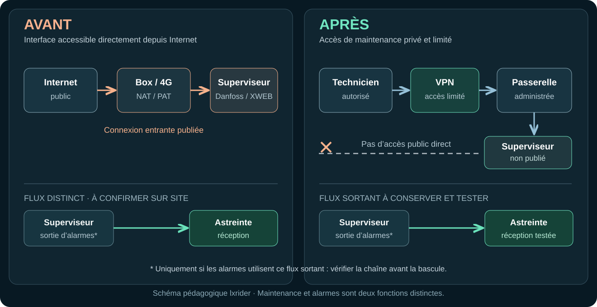
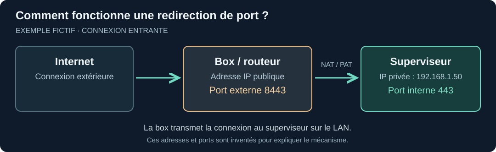
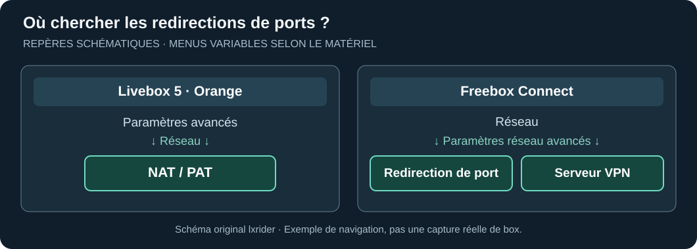

+++
title = "Sécuriser sa supervision frigorifique : guide pratique pas à pas"
description = "Danfoss, XWEB, box Internet et télémaintenance : sécuriser un accès distant sans interrompre le froid, les alarmes ou l'astreinte."
date = 2026-10-21
draft = false
template = "doc-page.html"

[extra]
author = "lxrider"
subtitle = "Danfoss, XWEB, box Internet et télémaintenance"
+++

*Danfoss, XWEB, box Internet et télémaintenance*

Une supervision frigorifique peut être accessible à distance pour permettre les interventions à distance. Cet accès facilite la maintenance, mais augmente considérablement le risque d'une cyberattaque. Suite aux incidents d'octobre 2026, le [CERT-FR recommande de supprimer cette exposition](https://cert.cyber.gouv.fr/alerte/CERTFR-2026-ALE-012/) et de rétablir l'accès par un VPN sécurisé ou un réseau protégé. **Le point délicat est de le faire sans perdre les alarmes, l'astreinte ni la capacité d'intervenir sur le froid.** Voici pour comprendre et sécuriser vos accès distants.

### Vous devez agir aujourd'hui ? Commencez ici.

| Votre situation | Première action utile |
| --- | --- |
| **Vous êtes frigoriste, sans accès à la box** | Relevez le modèle et la version du superviseur, la box/4G utilisée et le contact d'astreinte. Signalez immédiatement le risque à l'exploitant et au responsable réseau. |
| **Vous gérez le réseau du site** | Vérifiez avec le frigoriste les accès entrants et les alarmes. Préparez sans attendre la restriction de l'accès public, l'accès privé et un éventuel repli. |
| **Vous gérez les comptes du superviseur** | Vérifiez les comptes par défaut, partagés ou inconnus. Organisez avec le mainteneur leur sécurisation sans interrompre les accès ou notifications nécessaires. |
| **Vous observez un accès ou une configuration suspects** | Ne suivez pas simplement la procédure préventive : prévenez le responsable d'incident et appliquez les consignes CERT-FR/constructeur. |

**Même sans droits réseau, vous pouvez faire avancer la protection : identifier le site concerné, les personnes à joindre et les fonctions à préserver.** L'exposition doit être traitée sans attendre la mise en place hypothétique d'une solution idéale. Votre action commence par un point de situation frigoriste / exploitant / prestataire(s). 

## 1. Comprendre le problème : pourquoi le superviseur est-il accessible ?

Une **adresse IP publique** permet à des équipements de communiquer avec Internet. Des équipements tels qu'une **box** ou un **routeur 4G** relient le réseau du magasin à Internet. Une règle de **redirection de port (NAT/PAT)** configurée sur l'équipement peut laisser entrer une connexion extérieure vers le superviseur. Il est alors possible que **l'interface du superviseur soit exposée publiquement**, c'est-à-dire accessible directement depuis Internet, sans passer par un accès privé. **Cela ne signifie pas que n'importe quel compte peut se connecter ou modifier des réglages.**

À l'inverse, **envoyer une alarme vers un prestataire** est généralement un échange *sortant*. Supprimer une redirection entrante n'oblige pas à couper tous les échanges sortants. Mais certaines télésurveillances interrogent le site depuis l'extérieur : **il faut identifier le fonctionnement réel avant de toucher au réseau.**

<figure class="research-figure">

<figcaption>Figure 1. Accès direct et accès privé contrôlé. Les flux d'alarme sont distincts et doivent être validés sur site. Schéma original lxrider.</figcaption>
</figure>

**Point essentiel :** vérifier la manière dont les alarmes sont envoyées et confirmer leur bonne réception après l’intervention.

**Comment vérifier ?** Avec l'accord du responsable réseau, essayez d'accéder à l'interface du superviseur depuis une connexion extérieure au magasin, par exemple un téléphone en 4G avec le Wi-Fi désactivé.

Si la page de connexion apparaît sans utiliser de VPN, **le superviseur est directement exposé sur Internet**, même s'il demande un mot de passe.

Cela ne signifie pas qu'il a déjà été piraté, mais **cet accès doit être sécurisé**.

## 2. Avant toute modification : qu'est-ce qui doit continuer à fonctionner ?

Avant toute modification, notez le **modèle et la version** du superviseur (Danfoss AK-SM/AK-SC ou XWEB), le chemin d'accès (box, 4G, VPN, PC froid), le prestataire de maintenance et le destinataire des alarmes. Précisez qui reçoit les alertes la nuit, comment il intervient et ce que prévoient le **contrat de télésurveillance** et, le cas échéant, les **clauses d'assurance**.

**Mini-RACI en cinq minutes :** renseignez un nom et un numéro pour chaque rôle. Une même personne peut remplir plusieurs rôles.

| Rôle | Responsabilité avant la bascule |
| --- | --- |
| **Exploitant → décide** | Autorise le changement, la fenêtre d'intervention et le repli. |
| **Prestataire IT / responsable réseau → réalise** | Configure et teste l'accès privé, contrôle les droits, puis retire la publication après autorisation. |
| **Frigoriste → valide** | Confirme que la télémaintenance et les fonctions de supervision/froid restent utilisables. |
| **Astreinte / télésurveilleur → informé** | Participe à l'essai d'alarme et confirme la réception ainsi que le moyen de secours. |

Si l'un de ces rôles manque, identifiez-le avant de poursuivre. **Aucune coupure de box, de WAN, de 4G ou de télémaintenance à l'aveugle.** Un contrat n'interdit pas de sécuriser : il impose de coordonner la décision et la continuité du service.

## 3. Repérer les accès existants sur la box ou le routeur

**Sur le réseau local (LAN)**, la box relie les équipements du magasin : superviseur, éventuellement PC froid, etc. Chaque appareil dispose généralement d'une **adresse IP privée**, par exemple `192.168.1.50` pour un superviseur fictif. Cette adresse sert à communiquer *dans le magasin* ; elle ne permet pas, à elle seule, d'accéder au superviseur depuis Internet.

Un appareil peut proposer plusieurs services, comme une interface Web ou un accès de maintenance. Un **port** est le numéro qui permet de joindre l'un de ces services. Par exemple, `443` est couramment utilisé pour le Web en HTTPS, **mais ce numéro dépend de la configuration réelle**.

La box dispose aussi d'une **adresse IP publique**, côté Internet. Une règle de **redirection de port (NAT/PAT)** peut lui demander de transmettre une connexion reçue sur un port externe vers l'adresse privée et le port interne d'un équipement.

<figure class="research-figure">
  
  <figcaption>Figure 2. Exemple fictif d'une redirection NAT/PAT. Les adresses et ports ne sont pas des réglages Danfoss ou XWEB à reproduire. Schéma original lxrider.</figcaption>
</figure>

**Lire le schéma :** `8443` est le **port externe** sur lequel la box reçoit la connexion ; `192.168.1.50` est l'**adresse privée** du superviseur ; `443` est le **port interne** vers lequel la box transmet cette connexion.

### Où trouver ces réglages ?

Avec la personne **autorisée à administrer le réseau**, cherchez une éventuelle redirection vers le superviseur ou le PC froid. Notez l'**équipement de destination**, le **port externe**, le **port interne** et, s'il est affiché, le **protocole** (TCP/UDP). **On relève les informations, sans modifier la box.**

**Pour retrouver ces réglages :** les menus ci-dessous sont deux **exemples de chemin dans une interface constructeur**. Ils ne correspondent pas à une installation auditée. Le chemin exact peut varier selon le modèle et la version de la box.

<figure class="research-figure">
  
  <figcaption>Figure 3. Où chercher les réglages réseau : repères schématiques lxrider, d'après l'<a href="https://assistance.orange.fr/ordinateurs-peripheriques/installer-et-utiliser/les-consoles-de-jeux/xbox/livebox-5-configurer-les-regles-nat-pour-pouvoir-utiliser-un-jeu-ou-une-application-serveur_287340-827962">assistance Orange (Livebox 5)</a> et l'<a href="https://assistance.free.fr/articles/1395">assistance Free (Freebox Connect)</a>.</figcaption>
</figure>

**Attention :** l'absence de règle NAT visible ne prouve pas que l'accès est sécurisé. Le responsable réseau doit aussi vérifier, selon le site, **IPv6, DMZ, autre routeur 4G, accès cloud ou téléassistance**. Une règle visible ne prouve pas non plus qu'une intrusion a eu lieu. Pas de test sur un réseau tiers sans autorisation.

**Vous n'avez pas accès à la box ?** Ne cherchez pas à contourner cette limitation. Notez le modèle du superviseur et le moyen de télémaintenance connu, puis contactez l'exploitant et le responsable réseau.

**Message prêt à transmettre :** « Sur le site [nom], la supervision [modèle] dispose d'un accès distant [connu / à confirmer]. Pouvez-vous vérifier s'il existe un accès direct depuis Internet et organiser sa protection ? Merci de confirmer avec le frigoriste et l'astreinte le fonctionnement des alarmes et de la télémaintenance avant toute modification. »

## 4. Remplacer l'accès direct par une connexion protégée

L'objectif est de **conserver la télémaintenance pour les personnes autorisées**, sans laisser l'interface du superviseur directement accessible depuis Internet.

### Quel accès privé choisir ?

**Réutiliser d'abord un VPN déjà administré.** Sinon, le responsable réseau ou un prestataire IT habilité choisit la solution la plus simple à maintenir.

| Situation sur site | Solution à examiner | Vérification indispensable |
| --- | --- | --- |
| VPN d'entreprise existant | Le réutiliser, en limitant l'accès au superviseur | Les droits donnent-ils accès uniquement aux équipements nécessaires ? |
| Box avec serveur VPN compatible | VPN de la box, par exemple [WireGuard sur certaines Freebox](https://assistance.free.fr/articles/1970) | Modèle compatible, accès des techniciens et filtrage |
| Petite installation sans VPN adapté | Routeur VPN administré ou passerelle dédiée | Responsable des mises à jour, des comptes et du dépannage |
| Routeur 4G ou parc multisite | Routeur VPN ou solution gérée par le prestataire | Continuité d'accès et d'astreinte en cas de panne |

**Une passerelle dédiée, c'est quoi ?** Un petit équipement qui permet aux techniciens autorisés de rejoindre le superviseur sur le réseau local. Un Raspberry Pi avec [Tailscale](https://tailscale.com/docs/features/subnet-routers) en est un exemple, **à condition d'être correctement administré**. Un routeur VPN professionnel peut aussi remplir ce rôle.

Cette passerelle doit donner accès **au seul superviseur et aux services utiles**, pas à tout le réseau du magasin. Ne l'ajoutez pas à un PC froid critique sans accord et analyse préalable.

**Et les accès Web ?** [Cloudflare Tunnel avec Access](https://developers.cloudflare.com/cloudflare-one/setup/secure-private-apps/private-web-app/) peut convenir à certaines applications Web compatibles. Il **ne constitue pas une solution par défaut** pour des interfaces anciennes Danfoss ou XWEB.

### Si le VPN n'est pas prêt : une protection temporaire

Un **pare-feu**, parfois intégré à la box, peut **autoriser ou refuser les connexions** selon leur origine. Le *filtrage par adresse IP source* consiste, par exemple, à n'autoriser que les connexions provenant de l'**adresse Internet publique connue du prestataire**, et à refuser les autres.

Cette adresse « source » indique **d'où vient la connexion** ; elle ne désigne pas le superviseur. Si l'adresse du prestataire change, la règle peut empêcher sa télémaintenance.

Le [CERT-FR](https://cert.cyber.gouv.fr/alerte/CERTFR-2026-ALE-012/) envisage ce filtrage **en urgence seulement** : il réduit l'exposition, mais **ne remplace pas un accès privé**. L'interface reste accessible depuis les adresses autorisées.

**À faire par le responsable réseau :** vérifier que le matériel permet ce filtrage, identifier les adresses du prestataire, confirmer les alarmes et prévoir le remplacement rapide de cette mesure provisoire. **Ne modifiez pas les règles à l'aveugle.**

### Vérifier les comptes, sans confondre les protections

En parallèle, faites examiner par le mainteneur les comptes **par défaut, partagés ou inutilisés**. Les comptes d'administration doivent avoir des mots de passe **uniques et robustes** ; leur modification doit préserver les accès ou services qui en dépendent.

**Changer un mot de passe ne ferme pas une exposition Internet.**

Pour les **XWEB EVO**, le bulletin Copeland demande le retrait de l'exposition publique. Cette génération n'étant plus corrigée, il faut aussi planifier une migration vers un équipement maintenu.

### Qui valide avant la bascule ?

- **Prestataire IT / responsable réseau :** teste l'accès privé et vérifie qu'il ne donne pas accès à tout le LAN.
- **Frigoriste :** confirme que la télémaintenance reste utilisable.
- **Astreinte :** confirme la réception d'une alarme de test prévue avec le frigoriste.
- **Exploitant :** autorise la bascule, sa fenêtre d'intervention et le repli prévu.

**Ensuite seulement**, le responsable réseau retire la publication directe. Les vérifications sont répétées après le changement.

## 5. Vérifier que tout fonctionne après l'intervention

Pendant la **fenêtre approuvée par l'exploitant**, le responsable réseau retire la publication directe, une fois la nouvelle voie d'accès vérifiée.

Le frigoriste contrôle le fonctionnement de l'installation ; l'astreinte confirme la réception des alertes. **Si un service indispensable ne fonctionne plus**, ils appliquent le repli prévu et font arbitrer la suite par l'exploitant. Toute protection provisoire doit avoir un responsable et une échéance.

### Checklist de fin d'intervention

- [ ] Superviseur, box/4G, PC froid et chemins d'accès identifiés.
- [ ] Exploitant, responsable réseau, frigoriste et astreinte identifiés ; intervention autorisée.
- [ ] Contrat, alarmes, dépendances et solution de repli vérifiés.
- [ ] Nouvelle télémaintenance testée avec un compte **autorisé** et accès **refusé** aux autres ; comptes à privilèges et mots de passe revus avec le mainteneur.
- [ ] Accès public direct retiré et absence de chemin direct résiduel vérifiée avec l'IT.
- [ ] Alarmes **émises et réellement reçues** par l'astreinte, avec un test convenu **sans perturber le procédé frigorifique**.
- [ ] Consignes, programmations de dégivrage, état des équipements et températures réelles, si pertinentes, contrôlés et comparés à l'état attendu.
- [ ] Procédure de secours, comptes, mises à jour et **responsable du maintien en sécurité** consignés.

**Si une compromission est suspectée :** ce guide de prévention ne suffit pas. Alertez le responsable d'incident et suivez les consignes applicables du **constructeur** et du **CERT-FR**, en préservant les constats. **Ni redémarrage, ni remise à zéro, ni changement de passerelle IP, ni désactivation générale d'UPnP/IPv6** ne doivent être improvisés comme geste préventif.

Une installation mieux protégée n'est pas simplement une installation moins accessible : c'est une installation dont **les bons intervenants conservent les bons accès, dont les alarmes arrivent et dont le froid reste maîtrisé**.

## Sources et documentation

- [CERT-FR — CERTFR-2026-ALE-012 : incident ciblant les contrôleurs à distance des installations de réfrigération](https://cert.cyber.gouv.fr/alerte/CERTFR-2026-ALE-012/) (version du 16 octobre 2026).
- [Copeland / Dixell France — Recommandations pour une utilisation sécurisée des superviseurs XWEB](https://dixell.fr/wp-content/uploads/2026/10/Recommandations-pour-une-utilisation-securisee-des-superviseurs-XWEB-v1.0.pdf) (14 octobre 2026).
- [Danfoss — AK-SM 800A User Guide](https://assets.danfoss.com/documents/latest/471013/BC337629891709en-000901.pdf) (juin 2026, notamment p. 30 et 35 ; **800A uniquement**).
- [Copeland / Dixell — Manuels XWEB EVO 5.6.0](https://webapps.copeland.com/Dixell/Content/Pages/Manuals/XWEBEVO/XWEBEVOV5.6.0OPERATION/XWEB-EVO-r5.6.0-OPR-EN.pdf) et [XWEB PRO 1.2](https://webapps.copeland.com/Dixell/Content/Pages/Manuals/XWEBPRO/XWEBPROV1.2OPERATION/XWEB-PRO-OPR-EN.pdf) : **versions distinctes**.
- [Orange — Livebox 5, NAT/PAT](https://assistance.orange.fr/ordinateurs-peripheriques/installer-et-utiliser/les-consoles-de-jeux/xbox/livebox-5-configurer-les-regles-nat-pour-pouvoir-utiliser-un-jeu-ou-une-application-serveur_287340-827962) ; [Free — paramètres réseau avancés](https://assistance.free.fr/articles/1395) ; [Tailscale — subnet routers et contrôle d'accès](https://tailscale.com/docs/features/subnet-routers).

*Ce guide ne remplace pas les consignes constructeur ni les décisions du responsable d’exploitation. © 2026 lxrider — Tous droits réservés.*
